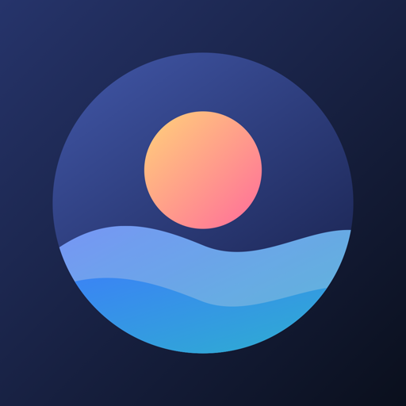
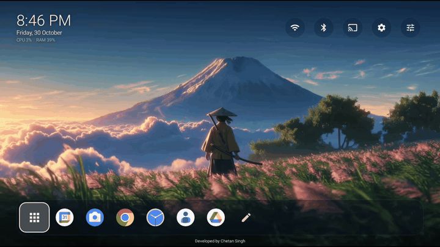
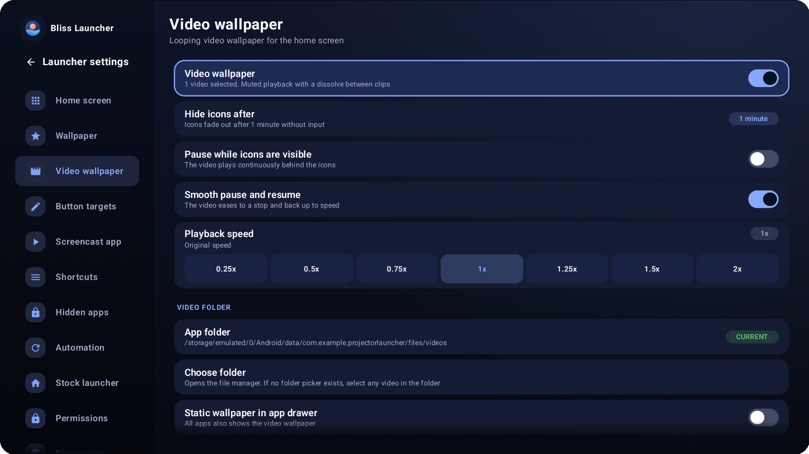
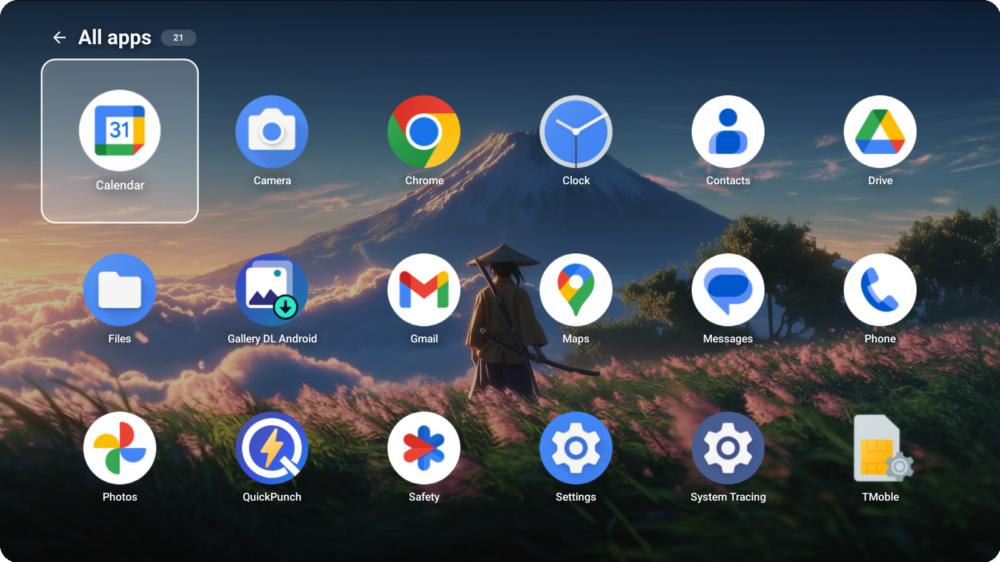
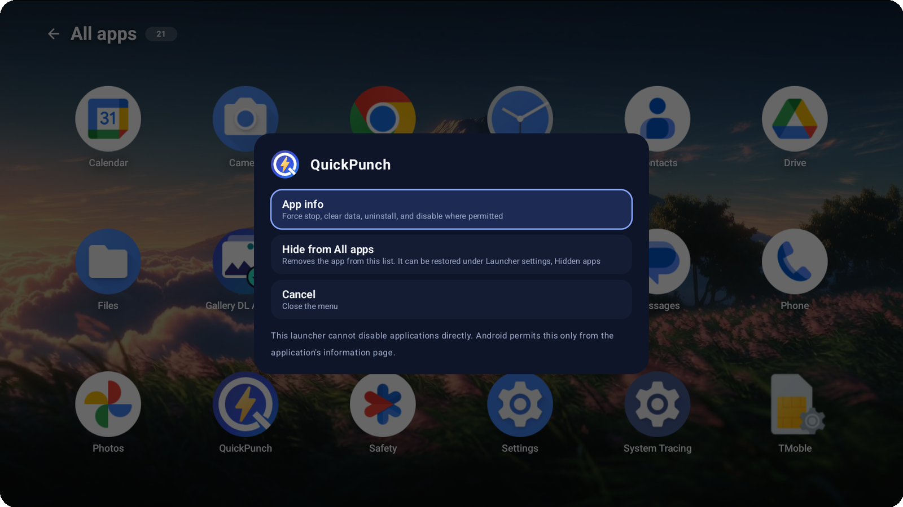
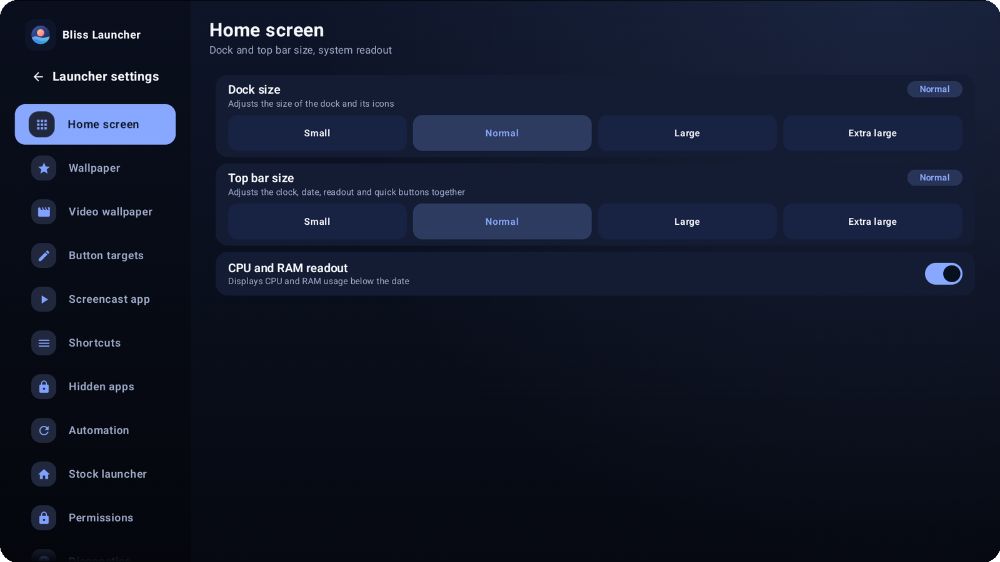
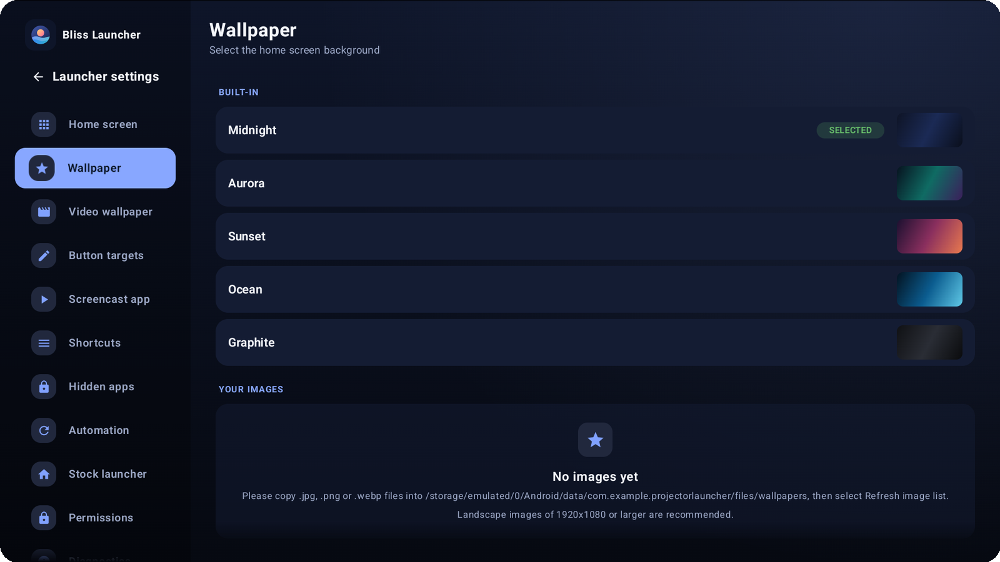

# Bliss Launcher

**A calm, beautiful home screen for projectors and Android TV.** 
Made to be used from the couch, with nothing but a remote.

---

## Why Bliss?

Most launchers are made for phones. A projector is different: you sit far away, you use a remote, and the screen is a big, quiet wall in a dark room.

Bliss Launcher is built for exactly that. It shows a clean clock, a handful of quick buttons, and your favourite apps, and then it gets out of the way so your wallpaper can shine.

---

## Highlights

### A living wallpaper

Play your own looping video as the home screen background, and make a whole room feel different. When the icons fade away after a moment of quiet, the picture takes over the entire wall.

- Use any of your own short videos
- Smooth, gentle slow down and speed up whenever the icons appear or disappear, with no sudden jumps
- Prefer something simple? Pick one of the built-in backgrounds instead

### Everything within reach of your remote

Every part of Bliss is designed around the arrow keys and the OK button. The highlight is large and clear, so you always know where you are, even from the back of the room.

Your top bar keeps the essentials one press away: Wi-Fi, Bluetooth, screen casting, system settings and launcher settings. A mouse works too, whenever you prefer it.

### Your favourite apps, always ready

Choose up to six apps for the dock at the bottom of the home screen. Open the full list at any time to see everything installed on your device in one tidy grid.

### Keep it tidy

Press and hold any app to see a small menu. From there you can open its information page or hide it from the list, and bring it back whenever you like.

### Make it yours

Change the size of the dock and the top bar, show or hide the live memory and processor readout, decide where each quick button leads, and pick how long the icons stay visible before fading.

  
  

---

## More to love

| | |
|---|---|
| **Starts by itself** | Bliss can open when the projector switches on and come back to the front after you leave another app. |
| **Light on memory** | Tuned for small devices with around 1 GB of memory, so everything stays responsive. |
| **Smooth navigation** | Moving around with the arrow keys feels immediate, and lists scroll exactly like the rest of Android. |
| **Screen casting shortcut** | Send your phone or laptop to the big screen with a single press. |
| **Calm, consistent look** | A deep midnight theme that is easy on the eyes in a dark room. |
| **Polite and clear** | Every message is written in plain, friendly language. |

---

## Getting started

1. Download the latest `BlissLauncher` file from the **Releases** page of this repository.
2. Copy it to your projector or TV and open it to install. Your device may ask you to allow installing from this source.
3. Press the **Home** button on your remote and choose **Bliss Launcher** when asked.
4. Open **Launcher settings** (the sliders icon at the top right) to add your own wallpaper and choose your dock apps.

**Works with:** Android 8.0 and newer, on projectors and Android TV devices.

---

## A small note

Bliss Launcher was designed and developed with care by **Chetan Singh**, first for a Magcubic projector, and shared here in case it makes your own movie nights a little nicer.

If you enjoy it, a star on this repository is always appreciated.
